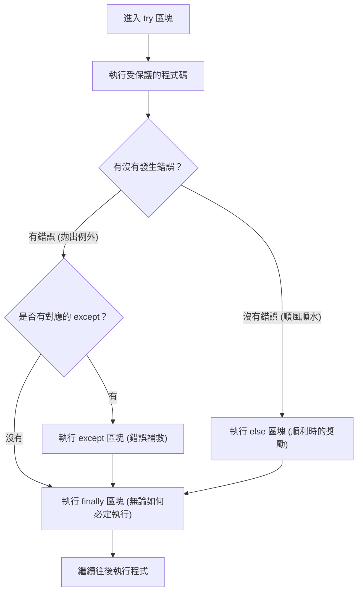

# Python 例外處理完全指南：從防呆到優雅容錯的完整攻略

> 本講義專為 Python 學習者量身打造，由淺入深帶你掌握「錯誤與例外處理」（Exception Handling）。從最基礎的 `try-except` 到進階的自訂例外與 Pythonic 設計哲學，讓你的程式碼不再動不動就崩潰！

---

## 目錄
1. [觀念起步走：什麼是「例外」（Exception）？](#1-觀念起步走什麼是例外exception)
   - [1.1 語法錯誤 (SyntaxError) vs 執行時期例外 (Exceptions)](#11-語法錯誤-syntaxerror-vs-執行時期例外-exceptions)
   - [1.2 為什麼需要例外處理？（安全氣囊哲學）](#12-為什麼需要例外處理安全氣囊哲學)
2. [基礎篇：初識 `try...except` 防護罩](#2-基礎篇初識-tryexcept-防護罩)
   - [2.1 基本語法與運作邏輯](#21-基本語法與運作邏輯)
   - [2.2 實例：除以零的危機 (`ZeroDivisionError`)](#22-實例除以零的危機-zerodivisionerror)
3. [進階控制：精準捕捉與處理多個例外](#3-進階控制精準捕捉與處理多個例外)
   - [3.1 常見內建例外清單](#31-常見內建例外清單)
   - [3.2 捕捉特定例外](#32-捕捉特定例外)
   - [3.3 多個 `except` 區塊（各司其職）](#33-多個-except-區塊各司其職)
   - [3.4 合併捕捉多個例外](#34-合併捕捉多個例外)
   - [3.5 取得錯誤詳細訊息：`as e`](#35-取得錯誤詳細訊息as-e)
   - [3.6 踩坑警報：為什麼千萬別寫裸寫的 `except:`？](#36-踩坑警報為什麼千萬別寫裸寫的-except)
4. [完整版圖：`try - except - else - finally` 四大金剛](#4-完整版圖try---except---else---finally-四大金剛)
   - [4.1 四大結構職責對照表與流程圖](#41-四大結構職責對照表與流程圖)
   - [4.2 沒出錯才做：`else` 區塊](#42-沒出錯才做else-區塊)
   - [4.3 風雨無阻必做：`finally` 區塊（資源釋放好幫手）](#43-風雨無阻必做finally-區塊資源釋放好幫手)
   - [4.4 完整四部曲綜合範例：檔案安全讀取](#44-完整四部曲綜合範例檔案安全讀取)
5. [主動出擊：使用 `raise` 拋出例外](#5-主動出擊使用-raise-拋出例外)
   - [5.1 為什麼要自己引爆錯誤？](#51-為什麼要自己引爆錯誤)
   - [5.2 範例：年齡與資料有效性檢查](#52-範例年齡與資料有效性檢查)
   - [5.3 重新拋出例外（捕捉後記記錄再拋出）](#53-重新拋出例外捕捉後記記錄再拋出)
6. [大師進階：自訂例外類別 (Custom Exceptions)](#6-大師進階自訂例外類別-custom-exceptions)
   - [6.1 繼承 `Exception` 打造專屬例外](#61-繼承-exception-打造專屬例外)
   - [6.2 實戰範例：銀行帳戶餘額不足例外](#62-實戰範例銀行帳戶餘額不足例外)
   - [6.3 例外鏈接 (Exception Chaining: `raise ... from ...`)](#63-例外鏈接-exception-chaining-raise--from-)
7. [Python 設計哲學：EAFP vs LBYL](#7-python-設計哲學eafp-vs-lbyl)
   - [7.1 什麼是 LBYL？（三思而後行）](#71-什麼是-lbyl三思而後行)
   - [7.2 什麼是 EAFP？（先斬後奏，大膽嘗試）](#72-什麼是-eafp先斬後奏大膽嘗試)
   - [7.3 實戰對比：字典取值與數字轉換](#73-實戰對比字典取值與數字轉換)
8. [實戰經典應用場景](#8-實戰經典應用場景)
   - [場景一：使用者輸入防呆無限迴圈](#場景一使用者輸入防呆無限迴圈)
   - [場景二：批次處理時跳過損毀資料（不中斷任務）](#場景二批次處理時跳過損毀資料不中斷任務)
9. [隨堂實戰練習與解答](#9-隨堂實戰練習與解答)
   - [練習 1：安心計算機（暖身題）](#練習-1安心計算機暖身題)
   - [練習 2：神秘密碼字典查閱（進階題）](#練習-2神秘密碼字典查閱進階題)
   - [練習 3：ATM 提款安全驗證系統（挑戰題）](#練習-3atm-提款安全驗證系統挑戰題)

---

## 1. 觀念起步走：什麼是「例外」（Exception）？

### 1.1 語法錯誤 (SyntaxError) vs 執行時期例外 (Exceptions)

寫程式時常聽到的「報錯」其實可以分成兩大類：

| 類型 | 發生時機 | 原因 | 能不能用例外處理捕獲？ | 範例 |
| :--- | :--- | :--- | :--- | :--- |
| **語法錯誤 (Syntax Error)** | 程式碼執行**前**（解析階段） | 寫錯語法、漏括號或引號、縮排不對 | ❌ 不能（程式根本還沒開始跑就掛了） | `print("Hello"`（少右括號） |
| **例外 (Exception / Runtime Error)** | 程式執行**中**（執行時期） | 語法正確，但運算遇到了意料之外的狀況 | ✅ 能！可以使用 `try-except` 妥善處理 | `10 / 0`、字串轉數字失敗 |

```python
# 這是語法錯誤 (SyntaxError)，直譯器直接拒絕執行：
# if True
#     print("Hi")  # 漏了冒號 :

# 這是例外 (ZeroDivisionError)，語法沒錯，但跑到了才會爆開：
x = 10
y = 0
result = x / y   # ZeroDivisionError: division by zero
```

---

### 1.2 為什麼需要例外處理？（安全氣囊哲學）

想像你正在開車（程式執行）：
- **沒有例外處理**：只要車輪壓到一顆小石頭（使用者輸入錯誤、網路瞬間斷線），車子立刻爆炸翻覆（程式 Crash，終端機噴出一長串紅色 Traceback，使用者被直接踢出系統）。
- **有了例外處理**：車上配備了**安全氣囊與避震器**。壓到石頭時，安全機制啟動，平穩減速，並在儀表板提醒駕駛「輪胎異常，請改道」，整台車依然可以安全運轉！

```mermaid
flowchart TD
    subgraph 沒有例外處理
        A1["開始執行程式"] --> B1["發生異常 (如除以0)"]
        B1 --> C1["❌ 程式立即強制中斷 (Crash)"]
        C1 --> D1["後面所有程式碼都無法執行！"]
    end

    subgraph 有例外處理 (try...except)
        A2["開始執行程式"] --> B2["進入 try 區塊"]
        B2 --> C2{"發生異常？"}
        C2 -- 是 --> D2["跳入 except 區塊攔截處置"]
        C2 -- 否 --> E2["順利完成 try 內容"]
        D2 --> F2["✅ 程式繼續往下正常運作！"]
        E2 --> F2
    end
```

> [!IMPORTANT]
> 例外處理的目的**不是掩蓋程式碼裡的邏輯 Bug**，而是**預測可能的外部異常情境**（例如使用者手滑打錯字、網路斷線、檔案不存在），並給予備案，維持系統的穩定與使用者體驗。

---

## 2. 基礎篇：初識 `try...except` 防護罩

### 2.1 基本語法與運作邏輯

最基本的防護罩由 `try` 與 `except` 兩個關鍵字組成：

```python
try:
    # 這裡放「可能出事」的危險程式碼
    ...
except:
    # 如果 try 裡面的程式碼出事了，會立刻跳到這裡執行補救措施
    ...
```

運作順序：
1. Python 會先執行 `try` 區塊裡的每一行程式碼。
2. 如果一切順利（沒爆錯），`except` 區塊會被**完全跳過**。
3. 如果 `try` 裡面**任何一行**發生錯誤，Python 會**立即中斷** `try` 剩餘的步驟，直接跳進 `except` 區塊執行救援！

---

### 2.2 實例：除以零的危機 (`ZeroDivisionError`)

在數學與程式中，「除以 0」是不被允許的操作。

#### ❌ 沒有防護的寫法（程式直接崩潰）：
```python
number = 100
divisor = 0
ans = number / divisor
print("計算成功！答案是：", ans)
print("程式繼續執行其他任務...")  # 這行永遠不會被執行
```
**執行結果：**
```text
ZeroDivisionError: division by zero
（程式崩潰中斷，後續動作完全停擺）
```

#### ✅ 加入 `try...except` 防護罩：
```python
number = 100
divisor = 0

try:
    ans = number / divisor
    print(f"計算成功！答案是：{ans}")
except:
    print("⚠️ 警告：除數不可以為 0，請重新檢查輸入！")

print("✅ 程式順利度過危機，繼續執行後續任務！")
```
**執行結果：**
```text
⚠️ 警告：除數不可以為 0，請重新檢查輸入！
✅ 程式順利度過危機，繼續執行後續任務！
```

---

## 3. 進階控制：精準捕捉與處理多個例外

### 3.1 常見內建例外清單

在 Python 中，不同的意外狀況有專屬的「例外型態」。常見的包括：

| 例外名稱 (Exception) | 發生時機與情境 | 觸發範例 |
| :--- | :--- | :--- |
| `ZeroDivisionError` | 任何數除以 0 | `10 / 0` |
| `ValueError` | 傳入的值型態雖然對，但內容不合適 | `int("abc")` |
| `TypeError` | 型態完全錯誤，不支援該運算 | `"10" + 5` |
| `IndexError` | 串列（List）索引超出範圍 | `lst = [1, 2]; lst[5]` |
| `KeyError` | 字典（Dict）找不到該鍵值（Key） | `d = {"a": 1}; d["b"]` |
| `FileNotFoundError` | 試圖打開一個根本不存在的檔案 | `open("ghost.txt")` |
| `AttributeError` | 物件沒有該屬性或方法 | `"hello".push()` |

---

### 3.2 捕捉特定例外

不要只是籠統地抓錯誤，指定特定的例外名稱可以讓程式處理得更精準：

```python
try:
    num = int(input("請輸入一個整數："))
    print("你輸入的數字是：", num)
except ValueError:
    print("❌ 輸入內容格式錯誤！必須要是純數字喔！")
```

---

### 3.3 多個 `except` 區塊（各司其職）

一段程式碼中可能隱藏著好幾種不同的地雷。你可以使用多個 `except` 區塊，就像醫院的分診處一樣，發燒去內科、骨折去外科：

```python
try:
    user_input = input("請輸入除數：")
    divisor = int(user_input)         # 地雷 1: 可能發生 ValueError (若使用者輸入 "abc")
    result = 100 / divisor             # 地雷 2: 可能發生 ZeroDivisionError (若使用者輸入 0)
    print(f"100 / {divisor} = {result}")

except ValueError:
    print("❌ 錯誤：請輸入有效的『整數』！")

except ZeroDivisionError:
    print("❌ 錯誤：數學上除數不能為 0！")
```

> [!TIP]
> 多個 `except` 是**由上至下依序比對**的。只要其中一個吻合，處理完該區塊後就會離開整組 `try-except`，不會再去比對其他 `except`。

---

### 3.4 合併捕捉多個例外

如果好幾種錯誤的處置方式完全一樣，可以使用**小括號元組 (tuple)** 合併在一起：

```python
try:
    items = ["蘋果", "香蕉", "橘子"]
    idx = int(input("想拿第幾種水果 (0~2)："))
    print(f"你拿到了：{items[idx]}")

except (ValueError, IndexError):
    # 無論是打錯字 (ValueError) 還是數字太大 (IndexError)，都印相同提示
    print("❌ 選擇無效！請輸入 0、1 或 2！")
```

---

### 3.5 取得錯誤詳細訊息：`as e`

有時候你想知道 Python 官方究竟噴了什麼錯誤訊息，或者需要把錯誤記錄到日誌（Log）中，可以使用 `as` 將例外物件命名為變數（習慣命名為 `e` 或 `err`）：

```python
try:
    num = int("ThisIsNotANumber")
except ValueError as e:
    print(f"捕捉到錯誤！例外類型：{type(e).__name__}")
    print(f"官方詳細說明訊息：{e}")
```
**執行結果：**
```text
捕捉到錯誤！例外類型：ValueError
官方詳細說明訊息：invalid literal for int() with base 10: 'ThisIsNotANumber'
```

---

### 3.6 踩坑警報：為什麼千萬別寫裸寫的 `except:`？

初學者常常偷懶寫出這樣的程式：

```python
# ⚠️ 極度危險的寫法！
try:
    do_something()
except:
    pass  # 假裝沒事發生
```

> [!WARNING]
> **絕對禁止隨意使用空的 `except:` 或全盤吞噬的 `except Exception:`！**
> 1. **它會吃掉使用者中斷訊號**：當你想在終端機按下 `Ctrl + C`（觸發 `KeyboardInterrupt`）停止程式時，程式會裝作沒事繼續狂跑，關都關不掉！
> 2. **它會掩蓋重大語法打字錯誤**：例如變數名稱拼錯（`NameError`），結果被你吞掉，你除錯半天完全找不到原因。
> 
> **良好習慣**：盡量指定確切的例外（如 `except ValueError:`）；若真的需要捕捉未知錯誤，請至少用 `except Exception as e:` 並把 `e` 印出來！

---

## 4. 完整版圖：`try - except - else - finally` 四大金剛

一個完整的例外處理結構，最多可以包含四個部分：



### 4.1 四大結構職責對照表

| 區塊關鍵字 | 必要性 | 執行時機與用意 |
| :--- | :--- | :--- |
| `try` | **必填** | 存放可能出錯的監控區碼。 |
| `except` | **必填 (或配 finally)** | **只有在出錯時**才會執行，負責防禦與救援。 |
| `else` | 選填 | **只有在完全沒出錯時**才會執行，適合放「只有成功了才該進行的後續動作」。 |
| `finally` | 選填 | **無論有沒有出錯、就算出錯後崩潰，都必定執行**，通常用於釋放資源（關閉檔案、中斷資料庫連線等）。 |

---

### 4.2 沒出錯才做：`else` 區塊

初學者常問：「為什麼不直接把成功的程式碼塞在 `try` 的最後面就好了？」
- **原因**：`try` 區塊裡面的程式碼越少、越精確越好！這樣才不會不小心抓到「後續程式碼」所引發的非預期錯誤。

```python
try:
    raw_age = input("請輸入你的年齡：")
    age = int(raw_age)
except ValueError:
    print("❌ 年齡必須是整數！")
else:
    # 只有當 int(raw_age) 毫無差錯轉換成功時，才會執行這裡
    print(f"🎉 登記成功！明年你就是 {age + 1} 歲了！")
```

---

### 4.3 風雨無阻必做：`finally` 區塊（資源釋放好幫手）

`finally` 是整個結構中最重承諾的區塊。無論世界末日、有沒有被 `except` 接住、甚至在 `try` 裡面執行了 `return`，`finally` 都**保證一定會跑完**！

最經典的情境：**檔案開啟後無論如何都要關閉**。

```python
file = None
try:
    print("1. 嘗試打開檔案...")
    file = open("sample_data.txt", "r", encoding="utf-8")
    content = file.read()
    print("2. 內容讀取成功！")
except FileNotFoundError:
    print("❌ 檔案不存在，無法讀取！")
finally:
    # 這是最後的清理工作
    if file and not file.closed:
        file.close()
        print("4. 安全關閉檔案資源！")
    print("5. [Finally] 清理檢查完畢！")
```

---

### 4.4 完整四部曲綜合範例：檔案安全讀取

我們把四個兄弟組合在一起看一遍：

```python
def divide_file_numbers(filename):
    file = None
    try:
        print(f"📖 準備讀取檔案：{filename}")
        file = open(filename, "r")
        content = file.read().strip()
        num = int(content)
        result = 100 / num

    except FileNotFoundError:
        print("❌ [Except] 找不到該檔案！")
    except ValueError:
        print("❌ [Except] 檔案內不是有效的整數！")
    except ZeroDivisionError:
        print("❌ [Except] 檔案內容為 0，無法當除數！")
    else:
        print(f"🎉 [Else] 計算一切順利！100 / {num} = {result}")
    finally:
        if file:
            file.close()
            print("🔒 [Finally] 檔案已成功關閉。")
        print("🏁 [Finally] 執行完畢，走出四部曲。\n")


# 測試：呼叫不存在的檔案
divide_file_numbers("not_exist.txt")
```
**執行結果：**
```text
📖 準備讀取檔案：not_exist.txt
❌ [Except] 找不到該檔案！
🏁 [Finally] 執行完畢，走出四部曲。
```

---

## 5. 主動出擊：使用 `raise` 拋出例外

前面都是在「被動防守」Python 產生的錯誤，但有時候是我們**主動發現邏輯不合規**，這時我們可以使用 `raise` 關鍵字主動拉響警報！

### 5.1 為什麼要自己引爆錯誤？

例如：你寫了一個計算開根號的函式，或是填寫年齡的表單。
如果使用者輸入 `-50` 歲，對 Python 來說 `-50` 是個合法的整數（不會自動跳出 `ValueError`），但在商業邏輯上**根本不存在負數年齡**！這時就該主動 `raise`！

---

### 5.2 範例：年齡與資料有效性檢查

```python
def register_user(username, age):
    if not username:
        raise ValueError("使用者名稱不能為空！")
    if age < 0 or age > 130:
        raise ValueError(f"不合理的年齡：{age}！年齡必須在 0 到 130 歲之間。")
    
    print(f"🎉 註冊成功！歡迎 {username}，年齡：{age} 歲。")


# 正確呼叫
register_user("Alice", 25)

# 不合理的呼叫（主動引爆防線）
try:
    register_user("Bob", -10)
except ValueError as error:
    print(f"⚠️ 攔截到註冊失敗原因：{error}")
```
**執行結果：**
```text
🎉 註冊成功！歡迎 Alice，年齡：25 歲。
⚠️ 攔截到註冊失敗原因：不合理的年齡：-10！年齡必須在 0 到 130 歲之間。
```

---

### 5.3 重新拋出例外（捕捉後記記錄再拋出）

在實際開發中，底層函式捕獲錯誤後，可能想先印出日誌（Log），然後**原封不動再把錯誤丟給上層呼叫者處理**。這時候只要寫單獨一個 `raise` 即可：

```python
def query_database():
    try:
        # 模擬資料庫連線超時
        raise ConnectionError("資料庫連線逾時！")
    except ConnectionError as e:
        print(f"📝 [日誌系統] 記錄錯誤事件到資料庫記錄檔：{e}")
        # 單獨寫 raise，會把剛剛抓住的例外再次丟出去
        raise 


# 上層程式
try:
    query_database()
except ConnectionError:
    print("🚨 [警報系統] 發送簡訊通知工程師搶修！")
```

---

## 6. 大師進階：自訂例外類別 (Custom Exceptions)

當 Python 內建的 `ValueError`、`TypeError` 無法精確表達你專案中的業務邏輯時，你可以自訂專屬的例外類別！

### 6.1 繼承 `Exception` 打造專屬例外

自訂例外非常簡單，只要繼承自 Python 的根基 `Exception` 即可：

```python
# 定義自訂例外
class InsufficientFundsError(Exception):
    """當帳戶餘額不足時引發此例外"""
    pass

class AccountLockedError(Exception):
    """當帳戶被凍結時引發此例外"""
    pass
```

---

### 6.2 實戰範例：銀行帳戶提款系統

```python
class BankAccount:
    def __init__(self, owner, balance, is_locked=False):
        self.owner = owner
        self.balance = balance
        self.is_locked = is_locked

    def withdraw(self, amount):
        if self.is_locked:
            raise AccountLockedError(f"🔒 提款失敗：{self.owner} 的帳戶已被凍結，請洽分行處理！")
        
        if amount > self.balance:
            shortage = amount - self.balance
            raise InsufficientFundsError(
                f"❌ 餘額不足！目前餘額：{self.balance} 元，提款金額：{amount} 元，尚缺：{shortage} 元。"
            )
        
        self.balance -= amount
        print(f"✅ 提款成功！提款：{amount} 元，剩餘餘額：{self.balance} 元。")


# 測試我們的專屬例外
account = BankAccount(owner="小明", balance=1000)

try:
    account.withdraw(1500)
except InsufficientFundsError as e:
    print(f"[處理餘額不足] {e}")
except AccountLockedError as e:
    print(f"[處理凍結帳戶] {e}")
```
**執行結果：**
```text
[處理餘額不足] ❌ 餘額不足！目前餘額：1000 元，提款金額：1500 元，尚缺：500 元。
```

> [!NOTE]
> 自訂例外讓程式碼的意圖變得無比清晰。在大型專案中，你可以為「購物車」、「會員權限」、「金流付款」分別建立專屬的錯誤體系。

---

### 6.3 例外鏈接 (Exception Chaining: `raise ... from ...`)

有時底層發生了底層錯誤（例如資料庫錯誤），你想轉換成高階的業務例外（例如「訂單建立失敗」），同時又想**保留原始錯誤的除錯堆疊記錄**，就可以使用 `raise ... from ...`：

```python
class OrderProcessingError(Exception):
    pass

def process_payment(amount):
    try:
        # 假設第三方金流 API 拋出連線超時
        raise TimeoutError("第三方金流伺服器無回應")
    except TimeoutError as original_error:
        # 將低階錯誤包裝成高階自訂例外，並保留根因 (from)
        raise OrderProcessingError("訂單付款處理失敗，請稍後再試！") from original_error
```

---

## 7. Python 設計哲學：EAFP vs LBYL

在寫例外處理時，有兩種截然不同的編程風格：

### 7.1 什麼是 LBYL？（三思而後行）
> **LBYL** = *Look Before You Leap*（跳躍前先看清楚）
> - 特色：在做動作之前，用滿滿的 `if-else` 嚴格檢查所有先決條件。
> - 風格：傳統 C / Java 常見風格。

### 7.2 什麼是 EAFP？（先斬後奏，大膽嘗試）
> **EAFP** = *Easier to Ask for Forgiveness than Permission*（請求原諒比爭取許可更容易）
> - 特色：直接假設會成功，大膽去執行；出事了再來 `except` 請求原諒！
> - 風格：**Python 官方極力推薦的 Pythonic 風格！**

---

### 7.3 實戰對比：字典取值

#### 方式一：LBYL 風格（一直用 `if` 檢查）
```python
user_profile = {"name": "小華", "level": "VIP"}

# LBYL: 先檢查 key 存在才敢拿
if "level" in user_profile:
    role = user_profile["level"]
else:
    role = "一般會員"
```

#### 方式二：EAFP 風格（先拿再說，拿不到再抓 KeyError）
```python
user_profile = {"name": "小華"}

# EAFP: 大膽拿，噴 KeyError 再說
try:
    role = user_profile["level"]
except KeyError:
    role = "一般會員"
```

> [!TIP]
> **為什麼 Python 偏好 EAFP？**
> 1. **效能優勢**：如果程式在 99% 的情況下都是正常的，LBYL 每次都要做 `if` 檢查會浪費時間；EAFP 平常完全零開銷，只有在出事那 1% 才會走進 `except`。
> 2. **避免競態條件 (Race Condition)**：在檔案讀取或多執行緒下，你先用 `if os.path.exists()` 檢查檔案在不在，檢查完的百萬分之一秒內檔案可能被其他程式刪了！直接 `try: open()` 才是最安全的。

---

## 8. 實戰經典應用場景

### 場景一：使用者輸入防呆無限迴圈

初學者寫命令列（CLI）程式最常見的崩潰就是使用者輸入字串導致 `int()` 報錯。利用 `while True + try-except` 打造完美防呆：

```python
def ask_positive_integer(prompt):
    while True:
        user_input = input(prompt)
        try:
            value = int(user_input)
            if value <= 0:
                print("⚠️ 數值必須大於 0，請重新輸入！")
                continue  # 重來
            return value   # 成功得到合格數字，跳出迴圈並回傳
        except ValueError:
            print("❌ 輸入格式不符！請輸入阿拉伯數字，例如：10、25。")


# 呼叫防呆函式
age = ask_positive_integer("請輸入您的年齡：")
print(f"🎉 驗證通過！您的年齡為：{age}")
```

---

### 場景二：批次處理時跳過損毀資料（不中斷任務）

假設你正在處理 10,000 筆商品資料，其中第 3 筆資料格式損毀。你絕對不希望整個系統直接當機，而是**跳過壞資料並記錄，其餘正常資料繼續算**：

```python
raw_records = [
    {"id": 1, "price": "100", "qty": "2"},
    {"id": 2, "price": "free", "qty": "5"},   # 損毀資料！"free" 無法轉整數
    {"id": 3, "price": "250", "qty": "4"},
    {"id": 4, "price": "50", "qty": "0"},     # 數量為 0
]

valid_total_amount = 0
failed_records = []

for record in raw_records:
    record_id = record["id"]
    try:
        price = float(record["price"])
        qty = int(record["qty"])
        subtotal = price * qty
        valid_total_amount += subtotal
        print(f"✅ 訂單 #{record_id} 計算完成：小計 {subtotal} 元")

    except (ValueError, KeyError) as e:
        print(f"⚠️ 訂單 #{record_id} 資料有誤，已略過處理！原因：{e}")
        failed_records.append(record_id)

print(f"\n📊 處理總結：")
print(f"- 總營業額累計：{valid_total_amount} 元")
print(f"- 異常訂單編號列表：{failed_records}")
```
**執行結果：**
```text
✅ 訂單 #1 計算完成：小計 200.0 元
⚠️ 訂單 #2 資料有誤，已略過處理！原因：could not convert string to float: 'free'
✅ 訂單 #3 計算完成：小計 1000.0 元
✅ 訂單 #4 計算完成：小計 0.0 元

📊 處理總結：
- 總營業額累計：1200.0 元
- 異常訂單編號列表：[2]
```

---

## 9. 隨堂實戰練習與解答

請同學親自動手練習，不要直接偷看解答喔！

---

### 練習 1：安心計算機（暖身題）

**題目需求**：
請撰寫一個函式 `safe_divide(a, b)`：
1. 傳入兩個參數 `a` 與 `b`。
2. 嘗試計算 `a / b` 並回傳結果。
3. 若 `b` 為 0，請捕捉 `ZeroDivisionError` 並回傳字串 `"除數不能為零！"`。
4. 若 `a` 或 `b` 傳入不是數字（例如字串 `"apple"`），請捕捉 `TypeError` 並回傳 `"型態錯誤，請傳入數字！"`。

<details>
<summary>👉 點擊展開「練習 1」參考解答</summary>

```python
def safe_divide(a, b):
    try:
        return a / b
    except ZeroDivisionError:
        return "除數不能為零！"
    except TypeError:
        return "型態錯誤，請傳入數字！"

# 測試用例
print(safe_divide(10, 2))       # 5.0
print(safe_divide(10, 0))       # 除數不能為零！
print(safe_divide("10", 2))     # 型態錯誤，請傳入數字！
```
</details>

---

### 練習 2：神秘密碼字典查閱（進階題）

**題目需求**：
設計一個小程式，提供一個字典如下：
```python
secret_codes = {
    "agent_007": "Goldfinger",
    "agent_008": "Thunderball",
    "agent_009": "Skyfall"
}
```
1. 讓使用者輸入代號（Key）。
2. 嘗試印出對應的機密代碼。
3. 如果輸入的代號不存在，捕捉 `KeyError` 並印出 `"⚠️ 查無此特務代號，存取遭到拒絕！"`。
4. 無論成功或失敗，最後務必印出 `"🔐 機密連線已中斷。"`（提示：善用 `finally`）。

<details>
<summary>👉 點擊展開「練習 2」參考解答</summary>

```python
secret_codes = {
    "agent_007": "Goldfinger",
    "agent_008": "Thunderball",
    "agent_009": "Skyfall"
}

code_name = input("請輸入特務代號 (如 agent_007)：")

try:
    mission = secret_codes[code_name]
    print(f"🎯 特務任務代號為：{mission}")
except KeyError:
    print("⚠️ 查無此特務代號，存取遭到拒絕！")
finally:
    print("🔐 機密連線已中斷。")
```
</details>

---

### 練習 3：ATM 提款安全驗證系統（挑戰題）

**題目需求**：
1. 定義一個自訂例外 `InvalidPasswordError`（繼承自 `Exception`）。
2. 定義一個函式 `verify_pin(pin)`：
   - 密碼必須是剛好 4 碼純數字字串（例如 `"1234"`）。
   - 如果長度不等於 4，主動拋出 `ValueError("密碼長度必須剛好 4 碼！")`。
   - 如果包含非數字字元（例如 `"12a4"`），主動拋出 `InvalidPasswordError("密碼必須全由數字組成！")`。
   - 密碼符合規格則印出 `"✅ 密碼格式驗證通過！"`。
3. 撰寫外層呼叫程式，捕捉上述兩種例外並顯示對應警告訊息。

<details>
<summary>👉 點擊展開「練習 3」參考解答</summary>

```python
# 1. 定義自訂例外
class InvalidPasswordError(Exception):
    """當密碼包含非數字字元時引發"""
    pass

# 2. 定義驗證函式
def verify_pin(pin):
    if len(pin) != 4:
        raise ValueError("密碼長度必須剛好 4 碼！")
    
    if not pin.isdigit():
        raise InvalidPasswordError("密碼必須全由數字組成！")
        
    print(f"✅ 密碼 [{pin}] 格式驗證通過！")

# 3. 測試呼叫
test_pins = ["123", "12a4", "8899"]

for p in test_pins:
    print(f"\n驗證密碼輸入：{p}")
    try:
        verify_pin(p)
    except ValueError as e:
        print(f"❌ [長度錯誤] {e}")
    except InvalidPasswordError as e:
        print(f"❌ [格式錯誤] {e}")
```
**測試輸出：**
```text
驗證密碼輸入：123
❌ [長度錯誤] 密碼長度必須剛好 4 碼！

驗證密碼輸入：12a4
❌ [格式錯誤] 密碼必須全由數字組成！

驗證密碼輸入：8899
✅ 密碼 [8899] 格式驗證通過！
```
</details>

---

## 結語與學習心法總結

例外處理是區分**初級程式設計師**與**專業工程師**的重要分水嶺：

1. **先防禦，再進攻**：在容易出現外部不確定性（使用者輸入、網路、檔案讀寫）的地方，一定要加上 `try-except`。
2. **具體精確**：絕對不要隨便寫裸露的 `except:`，優先捕捉具體的例外型態。
3. **分工清楚**：`try` 負責嘗試、`except` 負責補救、`else` 負責成功獎勵、`finally` 負責清理善後。
4. **大膽優雅**：熟悉 Python 的 **EAFP** 哲學，善用例外機制讓程式碼兼具閱讀性與強韌度！
