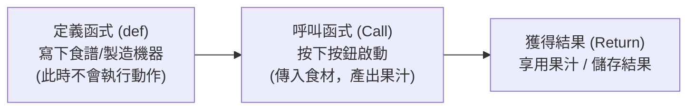

# Python 函式呼叫指南：從零開始學會使用 Function

> 本講義專為 Python 初學者設計，帶你徹底搞懂函式「如何呼叫」、「如何傳遞參數」以及「如何接收結果」！

---

## 目錄
1. [觀念起步走：什麼是「呼叫函式」？](#1-觀念起步走什麼是呼叫函式)
2. [呼叫的靈魂：神奇的小括號 `()`](#2-呼叫的靈魂神奇的小括號-)
3. [傳遞資料給函式：三種常見的引數傳遞方式](#3-傳遞資料給函式三種常見的引數傳遞方式)
   - [3.1 位置引數 (Positional Arguments)](#31-位置引數-positional-arguments)
   - [3.2 關鍵字引數 (Keyword Arguments)](#32-關鍵字引數-keyword-arguments)
   - [3.3 預設引數 (Default Arguments)](#33-預設引數-default-arguments)
   - [3.4 語法大禁忌：順序不能亂！](#34-語法大禁忌順序不能亂)
4. [如何拿取結果：回傳值 (Return Value)](#4-如何拿取結果回傳值-return-value)
   - [4.1 用變數接住回傳值](#41-用變數接住回傳值)
   - [4.2 最常踩的雷：`print()` 與 `return` 的愛恨情仇](#42-最常踩的雷print-與-return-的愛恨情仇)
5. [初學者必備！函式呼叫報錯與除錯指南](#5-初學者必備函式呼叫報錯與除錯指南)
6. [進階補充：可變引數簡介 (*args, **kwargs)](#6-進階補充可變引數簡介-args-kwargs)
7. [隨堂實戰練習與解答](#7-隨堂實戰練習與解答)

---

## 1. 觀念起步走：什麼是「呼叫函式」？

在學習寫程式時，函式（Function）就像是一台**果汁機**或**自動販賣機**：
- **定義函式 (`def`)**：相當於把這台機器**製造**出來、寫好內部電路與配方。
- **呼叫函式 (Call)**：相當於**按下啟動按鈕**，真正讓機器開始運作！



> [!IMPORTANT]
> **千萬記住**：光是寫了 `def my_function():`，裡面的程式碼是**不會**自己跑的！一定要透過「呼叫」，程式才會去執行函式裡的內容。

其實你早就在天天呼叫函式了！Python 內建的許多工具都是函式：
```python
print("Hello!")   # 呼叫 print 函式，傳入字串 "Hello!"
len("Python")     # 呼叫 len 函式，計算長度
type(100)         # 呼叫 type 函式，取得資料型態
```

---

## 2. 呼叫的靈魂：神奇的小括號 `()`

呼叫函式的基本語法非常簡單：

```text
函式名稱()
```

### 陷阱警示：有括號 vs 沒有括號

初學者最常犯的錯誤之一，就是**忘了加上小括號**：

```python
def say_hello():
    return "哈囉！你好！"

# 錯誤示範：沒有加括號
print(say_hello)
# 輸出結果類似：<function say_hello at 0x000001234ABCD>
# 解釋：沒有括號時，你只是在稱呼這台機器的名字，並沒有按下啟動開關！

# 正確示範：加上括號呼叫
print(say_hello())
# 輸出結果：哈囉！你好！
# 解釋：加上小括號 () 才是真正「啟動執行」！
```

---

## 3. 傳遞資料給函式：三種常見的引數傳遞方式

很多函式需要我們「餵」它資料才能工作。我們傳進去的資料稱為**引數 (Arguments)**。

假設我們有一個計算 BMI 的函式：
```python
def calculate_bmi(height_m, weight_kg):
    bmi = weight_kg / (height_m ** 2)
    return round(bmi, 2)
```

我們可以透過以下幾種方式來呼叫它：

### 3.1 位置引數 (Positional Arguments)
依照定義時的**排列順序**，一個蘿蔔一個坑地傳入：

```python
# 身高 1.75 公尺，體重 68 公斤
my_bmi = calculate_bmi(1.75, 68)
print("我的 BMI 是:", my_bmi) # 輸出: 22.2
```

> [!WARNING]
> **位置順序絕對不能錯！**  
> 如果你寫成 `calculate_bmi(68, 1.75)`，Python 就會把 68 當作身高（68公尺的巨人！），計算出的 BMI 會完全錯誤！

---

### 3.2 關鍵字引數 (Keyword Arguments)
在呼叫時直接「指名道姓」指定參數名稱：

```python
# 明確指定參數名稱
my_bmi = calculate_bmi(weight_kg=68, height_m=1.75)
print("我的 BMI 是:", my_bmi) # 輸出: 22.2
```

**關鍵字引數的好處**：
1. **順序可以對調**：不用死記誰前誰後。
2. **可讀性極高**：別人（或一個月後的你自己）看程式碼時，一眼就看出每個數字代表什麼意義。

---

### 3.3 預設引數 (Default Arguments)
在定義函式時，可以給參數一個預設值。呼叫時如果沒有特別給值，就會使用預設值。

```python
def greet(name, title="同學"):
    return f"{name} {title}，歡迎來上課！"

# 情況 1：只給必填的 name，title 使用預設值 "同學"
print(greet("小明"))
# 輸出: 小明 同學，歡迎來上課！

# 情況 2：想要自訂 title，蓋過預設值
print(greet("王小美", title="助教"))
# 輸出: 王小美 助教，歡迎來上課！
```

---

### 3.4 語法大禁忌：順序不能亂！
當你把「位置引數」與「關鍵字引數」混在一起使用時，必須遵守一條嚴格規定：

> [!CAUTION]
> **位置引數必須在關鍵字引數前面！**

```python
def order_drink(item, ice="微冰", sugar="半糖"):
    return f"點了一杯 {item}，冰塊：{ice}，甜度：{sugar}"

# 正確呼叫：先傳位置引數，再傳關鍵字引數
print(order_drink("珍珠奶茶", sugar="無糖"))

# 錯誤呼叫：關鍵字引數後面又接位置引數 (SyntaxError)
# order_drink(ice="去冰", "紅茶")  # 這行會報錯！SyntaxError: positional argument follows keyword argument
```

---

## 4. 如何拿取結果：回傳值 (Return Value)

函式執行完畢後，通常會把運算結果用 `return` 「交還」給呼叫它的人。

### 4.1 用變數接住回傳值
最標準的做法，就是用一個變數把函式回傳的東西存起來：

```python
def add(a, b):
    return a + b

# 呼叫 add(3, 5)，並把回傳的 8 存入變數 total
total = add(3, 5)
print("總和是:", total) # 輸出: 8

# 也可以直接把回傳值拿來做其他運算或呼叫其他函式
print(add(10, 20) * 2)  # 輸出: 60
```

---

### 4.2 最常踩的雷：`print()` 與 `return` 的愛恨情仇

很多新手會混淆「在函式裡印出結果」和「把結果回傳出來」：

```python
# 函式 A：只負責印，沒有 return
def func_with_print(a, b):
    print("內部印出:", a + b)

# 函式 B：認真計算並 return
def func_with_return(a, b):
    return a + b
```

看看呼叫它們時的差別：

```python
# 測試函式 A
result_a = func_with_print(3, 5)  # 螢幕會印出 "內部印出: 8"
print("變數 result_a 的內容是:", result_a)
# 輸出: None (因為沒有 return，變數其實什麼都沒拿到！)

# 測試函式 B
result_b = func_with_return(3, 5) # 螢幕不會有動靜
print("變數 result_b 的內容是:", result_b)
# 輸出: 8 (成功拿到成果！)
```

> [!TIP]
> **比喻記憶法**：
> - `print()` 就像是在廚房裡大聲喊：「菜做好了！」（只有聲音，顧客桌上沒菜）。
> - `return` 就像是服務生把菜真正端到顧客桌上（呼叫者可以用盤子接住這道菜）。

---

## 5. 初學者必備！函式呼叫報錯與除錯指南

寫程式難免出錯，看懂錯誤訊息，你就能自己當工程師解 bug！

| 錯誤類型 | 常見錯誤訊息範例 | 發生原因 | 修正方式 |
| :--- | :--- | :--- | :--- |
| **引數數量太少** | `TypeError: func() missing 1 required positional argument: 'x'` | 函式需要 2 個引數，但你只給了 1 個。 | 補足缺少的值。 |
| **引數數量太多** | `TypeError: func() takes 2 positional arguments but 3 were given` | 函式只接受 2 個引數，你卻塞了 3 個進去。 | 檢查並移除多餘的引數。 |
| **順序擺放錯誤** | `SyntaxError: positional argument follows keyword argument` | 把沒有指定名稱的位置引數放在關鍵字引數後面。 | 把位置引數挪到最前面。 |
| **找不到函式名稱** | `NameError: name 'my_func' is not defined` | 1. 拼字打錯<br>2. 函式寫在呼叫的下方，Python 還沒讀到。 | 檢查拼字，並確認函式定義在呼叫之前。 |
| **忘了小括號** | 輸出結果出現 `<function ...>` | 只寫了函式名字，忘了加 `()` 呼叫執行。 | 加上 `()`。 |

---

## 6. 進階補充：可變引數簡介 (*args, **kwargs)

> 這是延伸補充知識，如果你剛學會基本呼叫，可以先瀏覽了解概念即可！

有時候我們不確定使用者到底會傳進來多少個引數：
- `*args`：代表可以接收「任意數量的位置引數」，會被打包成一個元組（Tuple）。
- `**kwargs`：代表可以接收「任意數量的關鍵字引數」，會被打包成一個字典（Dictionary）。

```python
def make_pizza(size, *toppings):
    print(f"製作一個 {size} 吋披薩，配料有：")
    for t in toppings:
        print(f" - {t}")

# 呼叫時，後面的配料愛傳幾樣就傳幾樣
make_pizza(12, "起司", "蘑菇", "青椒", "義式香腸")
```

---

## 7. 隨堂實戰練習與解答

請在 Python 環境中練習呼叫以下函式，檢驗自己的理解程度！

### 挑戰一：飲料店結帳系統呼叫
已知店家定義了以下結帳函式：
```python
def buy_coffee(cups, size="大杯", extra_shot=False):
    base_price = 60 if size == "中杯" else 80
    shot_price = 15 if extra_shot else 0
    total = (base_price + shot_price) * cups
    return total
```
**任務**：
1. 買 2 杯「中杯」咖啡，不加濃縮（使用**位置引數**呼叫）。
2. 買 3 杯「大杯」咖啡，加濃縮（使用**關鍵字引數**呼叫）。
3. 買 1 杯大杯、不加濃縮（只傳必要的引數，利用**預設引數**特性呼叫）。

---

### 挑戰二：抓出錯誤！(Debug 找碴題)
以下每一行呼叫都有問題，請指出是哪種錯誤並修復它：
```python
# 函式定義
def introduce(name, age, city="台北"):
    return f"大家好，我是{name}，今年{age}歲，住在{city}。"

# 請找出以下呼叫的問題：
# 1. print(introduce)
# 2. introduce("小華")
# 3. introduce(age=18, "大明")
# 4. introduce("志豪", 25, "台中", "學生")
```

---

### 答案與解析（點開確認）

<details>
<summary>👉 點擊查看【挑戰一】參考解答</summary>

```python
# 1. 2杯中杯，不加濃縮 (位置引數)
price1 = buy_coffee(2, "中杯", False)
print("訂單 1 金額:", price1) # 輸出: 120

# 2. 3杯大杯，加濃縮 (關鍵字引數)
price2 = buy_coffee(cups=3, size="大杯", extra_shot=True)
print("訂單 2 金額:", price2) # 輸出: 285

# 3. 1杯大杯、不加濃縮 (利用預設值)
# 因為 size 預設是大杯、extra_shot 預設是 False，所以只需要傳 cups！
price3 = buy_coffee(1)
print("訂單 3 金額:", price3) # 輸出: 80
```
</details>

<details>
<summary>👉 點擊查看【挑戰二】參考解答</summary>

1. **`print(introduce)`**
   - **錯誤**：少了小括號 `()`，只會印出函式物件記憶體位置。
   - **修正**：`print(introduce("小明", 20))`
2. **`introduce("小華")`**
   - **錯誤**：`TypeError`，缺少必要的引數 `age`。
   - **修正**：`introduce("小華", 18)`
3. **`introduce(age=18, "大明")`**
   - **錯誤**：`SyntaxError`，位置引數不可以放在關鍵字引數後面。
   - **修正**：`introduce("大明", age=18)` 或 `introduce("大明", 18)`
4. **`introduce("志豪", 25, "台中", "學生")`**
   - **錯誤**：`TypeError`，給了 4 個引數，但函式最多只接受 3 個。
   - **修正**：移除多餘引數 -> `introduce("志豪", 25, "台中")`
</details>

---
*祝學習順利！快樂寫 Code！*
